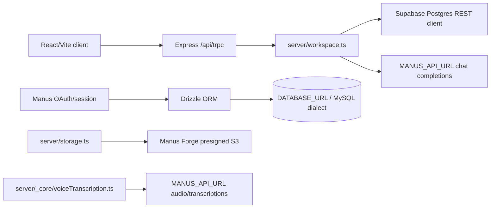

# ContextCore Audio/Video RAG Audit

**Audit date:** 2026-10-09  
**Repository:** `DEBARGHA1234/audio-video-rag-system`  
**Scope:** server, client, shared, Drizzle files, root configuration, and current Supabase schema.  
**Change policy:** This audit intentionally makes no application-code changes.

## Executive summary

ContextCore is currently a credible **text-first RAG workspace shell**, not yet an audio/video RAG system. It has a React/Vite frontend, Express/tRPC backend, Manus OAuth scaffolding, a Supabase-backed persistence layer for the RAG workspace, a pgvector column and HNSW index in the database, answer caching, dashboard telemetry, and evaluation UI. However, the application does not write embeddings or execute vector search, ingestion is synchronous, uploaded binary files are not persisted or parsed, direct URLs are not fetched, and the existing Whisper-compatible transcription helper is not connected to any route or ingestion job.

The requested next phase should preserve the existing UI and tRPC contracts while replacing the current synchronous text path with a durable media-ingestion pipeline and real hybrid retrieval. The highest-risk decision is the database consolidation: the current Manus auth/user path still uses Drizzle with the generated MySQL schema, while RAG data uses Supabase Postgres through a server-only service-role client.

## Current architecture

### Frontend

- React 19 with Vite, Wouter, TanStack Query, tRPC client, Tailwind/Radix UI.
- Main workspace page: `client/src/pages/Home.tsx`.
- Documents list: `client/src/pages/Documents.tsx`.
- Admin and evaluation pages consume tRPC data from the workspace router.
- The file input currently accepts PDF, DOCX, Markdown, CSV, JSON, TXT, MP3, WAV, and M4A. It does **not** accept MP4, MOV, WEBM, or MKV.
- Text-like files are read into browser memory with `FileReader` and sent as text in a tRPC mutation. Non-text files are not uploaded; the client sends a placeholder such as `Uploaded file: filename`.
- Theme and sidebar width use browser storage. Session forwarding also uses `sessionStorage` as part of the Manus preview/auth scaffold.

### Backend

- `server/_core/index.ts` creates the Express server, parses JSON/urlencoded bodies up to 50 MB, serves `/api/health`, registers OAuth routes, and mounts the tRPC router.
- No Helmet, rate limiter, structured logger, background queue, worker process, or media-processing pipeline is currently configured.
- `server/routers.ts` exposes public procedures for overview, document pagination, ingestion, asking questions, evaluations, admin metrics, and settings. Workspace procedures are currently `publicProcedure`; they are not scoped to the authenticated Manus user.
- `server/workspace.ts` is the active application service for ingestion, retrieval, answer generation, cache writes, query logs, citations, activity events, evaluations, and settings.

## Database and source of truth

### Current state

There are currently two database paths:

1. **Generated auth/user path:**
   - `drizzle/schema.ts` defines only a MySQL `users` table.
   - `server/db.ts` imports `drizzle-orm/mysql2` and uses `DATABASE_URL`.
   - `server/_core/sdk.ts` uses `getUserByOpenId` and `upsertUser` for Manus OAuth identity persistence.
   - `drizzle.config.ts` declares `dialect: "mysql"`.

2. **RAG workspace path:**
   - `server/supabase.ts` creates a server-only `@supabase/supabase-js` client using `SUPABASE_URL` and `SUPABASE_SERVICE_ROLE_KEY`.
   - RAG tables, seed rows, RLS policies, pgvector, HNSW indexing, cache, activity, telemetry, evaluation cases/runs/results, and settings are in Supabase Postgres.
   - `supabase-evaluation-trend.sql` is checked into the repository but is not a Drizzle migration.

The project is therefore **not yet one database**. The requested Postgres consolidation must explicitly decide how the Manus OAuth `users` table and any existing production user rows move into Supabase. No destructive migration should run without a printed migration plan and user confirmation.

### Existing Supabase RAG tables

The current Supabase schema contains the following logical areas:

- Workspaces and members.
- Documents and document chunks.
- Query logs and query citations.
- Answer cache.
- Evaluation cases, runs, results, and daily trend rows.
- Activity events, daily usage telemetry, and workspace settings.

`document_chunks.embedding` is declared as `extensions.vector(384)`, and `chunks_embedding_hnsw_idx` exists with cosine operator support. Seed/demo chunks currently have no populated embeddings.

## Embeddings and retrieval

### Where embeddings are stored

Embeddings are intended to be stored in `public.document_chunks.embedding` as a 384-dimensional pgvector value. The current application does not populate this field during ingestion. The seed chunks also have null embeddings.

### How embeddings are searched

They are currently **not searched**. `server/workspace.ts`:

- Loads up to 100 documents from Supabase.
- Normalizes the question with lowercase/whitespace cleanup.
- Scores each document by term substring presence.
- Applies hard-coded question/document suffix rules for the four demo questions.
- Sorts that lexical score and returns up to three documents.

There is no pgvector distance operator query, no full-text `tsvector` column/query, no reciprocal rank fusion, and no LLM reranking. The HNSW index is database-ready infrastructure, not an active retrieval path.

### Cache

`answer_cache` is queried by workspace, corpus version, and normalized question. Cached answers are written after non-cache queries. The current cache stores answer text and a JSON citation payload but is not invalidated through a corpus version increment during ingestion; ingestion currently leaves the workspace corpus version unchanged.

## Ingestion behavior

### Current flow

Ingestion is synchronous inside the tRPC mutation:

1. Client sends either pasted text/URL or a filename/placeholder.
2. `ingestSource` normalizes the text, derives a kind, computes a SHA-256 content hash, chunks on words with 80-word chunks and 12-word overlap, and inserts the document.
3. It inserts document chunks and an activity event.
4. It immediately returns an `indexed` document.

There is no queued, transcribing, chunking, embedding, ready, or failed state machine. The current status enum is only `indexed | processing | failed`, and `processing` is not used by the active ingestion flow.

### URL behavior

A pasted HTTP/HTTPS source is **not fetched**. If no explicit content is supplied, the server stores synthetic text saying the source was fetched and normalized. There is no SSRF guard, DNS resolution, redirect re-check, private-IP block, response-size cap, or timeout policy.

### File behavior

The browser reads supported text files directly, but binary files are represented by placeholder text. The existing `server/storage.ts` helper can obtain a Forge presigned PUT URL and upload to S3-compatible storage, but the active workspace ingestion route does not call it.

### Deduplication

A content hash is computed, but the active insert path does not use an upsert or a unique-conflict response to deduplicate. The database has a `(workspace_id, content_hash)` unique constraint, so repeated content can surface as a database error rather than a controlled dedupe result.

## Audio/video support

### Existing helper

`server/_core/voiceTranscription.ts` contains an unconnected helper called `transcribeAudio`:

- Downloads an `audioUrl` with plain `fetch`.
- Applies a hard-coded 16 MB limit.
- Sends multipart form data to `${MANUS_API_URL}/v1/audio/transcriptions`.
- Uses `whisper-1` and `verbose_json`.
- Returns Whisper-style timestamped segments with `start` and `end` fields.
- Supports audio MIME mappings including MP3, WAV, WebM, OGG, M4A, and MP4 audio.

The helper is not imported by `server/routers.ts` or `server/workspace.ts`, and no transcription table exists in the current schema. It does not process video containers, extract audio, identify speakers, enforce duration, or run as a background job.

### Current UI gap

The UI mentions “audio sources” but only accepts `.mp3`, `.wav`, and `.m4a`. It does not accept `.mp4`, `.mov`, `.webm`, or `.mkv`, and it does not render a player or timestamp citations.

## LLM usage

There are two relevant paths:

1. `server/workspace.ts` has a local `generateWithPlatform` function that calls `${MANUS_API_URL}/v1/chat/completions` with `MANUS_API_KEY`. It does not explicitly choose a model. It wraps the selected document text in a simple context prompt and asks for a concise grounded answer.
2. `server/_core/llm.ts` is a broader Manus LLM helper with model listing, multimodal content types, streaming/non-streaming request support, and structured output support. The active workspace answer path does not use this helper.

If the platform call is unavailable, the workspace falls back to deterministic answer templates for the demo topics or a summary of the highest-ranked document. There is no explicit low-score refusal threshold, no robust prompt-injection delimiter policy, and no LLM-based top-20-to-top-5 reranker.

## Evaluation behavior

The evaluation UI reads persisted evaluation cases, one demo evaluation run, demo result rows, and seven daily trend rows from Supabase. The `runEvaluation` mutation currently creates a new completed run by copying the existing summary values; it does not execute a golden set, call an LLM judge, or calculate context precision, faithfulness, answer relevancy, or context recall from real query outputs.

There is no `eval/golden.json`, no `pnpm eval` script, no context recall metric in the current schema/API, and no non-demo evaluation pipeline. Existing rows are correctly labelled with `is_demo = true` and should remain visibly labelled as demo data until real evaluations exist.

## Security and operational gaps

- No SSRF protection for link ingestion.
- No MIME/extension allowlist enforced server-side.
- No max media duration setting.
- No per-route rate limits.
- No Helmet security middleware.
- No pino or equivalent structured logger.
- Raw exception messages can reach tRPC error responses.
- Workspace procedures are public and use a fixed workspace ID; Manus identity is not used for workspace authorization.
- Supabase service-role access is server-only in source and is not present in the client bundle, but the environment variable is not represented in a checked-in `.env.example`.
- The transcription helper downloads arbitrary URLs without the SSRF protections required for ingestion.
- No background worker or durable job retry mechanism.

## Dependencies and configuration findings

### Clearly used

- `@supabase/supabase-js`: active RAG persistence client.
- `drizzle-orm` and `mysql2`: active generated auth/user persistence path.
- `@aws-sdk/client-s3` and `@aws-sdk/s3-request-presigner` are declared but the inspected application storage helper uses the Manus Forge presign HTTP API instead of these SDK packages.
- `axios`: used by the Manus SDK wrapper.
- `dotenv`: imported by the server bootstrap.
- `@types/google.maps`: referenced by `client/src/components/Map.tsx`, although the map component is not part of the main RAG workspace route.

### Likely unused or cleanup candidates

- `add` is a stray dev dependency and has no package import usage.
- The two AWS SDK packages have no source imports in the repository; verify template/deployment expectations before removal.
- `@types/google.maps` is only needed if the map showcase/component remains in the build; verify before removal.
- The dependency list contains no queue/worker package, Redis client, FFmpeg wrapper, Helmet, express-rate-limit, pino, OpenAI SDK, Postgres driver, `knip`, or `depcheck`.

Dependency removal should be done one package at a time with a frozen-lockfile install, type check, test, and production build after each change.

## Environment variables referenced by source

The source references these names:

| Variable | Current purpose | Secret? |
|---|---|---:|
| `DATABASE_URL` | Drizzle/MySQL auth-user database and Drizzle CLI | Yes |
| `SUPABASE_URL` | Server-only Supabase project URL | No, but keep server-only for current architecture |
| `SUPABASE_SERVICE_ROLE_KEY` | Server-only Supabase privileged key | **Yes** |
| `MANUS_API_URL` | Manus Forge base URL for LLM, storage, images, transcription, and related services | Yes/host-provided |
| `MANUS_API_KEY` | Manus Forge service credential | **Yes** |
| `MANUS_API_BROWSER_KEY` | Public platform runtime config path may expose a browser-safe value if supplied | Browser-safe only |
| `MANUS_PROJECT_ID` | Manus project identity | Host-provided |
| `MANUS_JWT_SECRET` | Session verification/signing | **Yes** |
| `MANUS_OAUTH_API_URL` | Manus OAuth server URL | No |
| `OWNER_OPEN_ID` | Assigns admin role to the configured owner | Sensitive identifier |
| `NODE_ENV` | Development/production behavior | No |
| `PORT` | HTTP listener port | No |

There is no checked-in `.env.example` at the time of audit.

## Recommended implementation order

1. Print and approve a non-destructive database migration plan. Consolidate the generated `users` table and all RAG tables into Supabase Postgres, preserve Manus OAuth identity values, and migrate data before removing MySQL.
2. Add the Postgres Drizzle dialect and `postgres-js` driver, convert the schema/migrations, and keep Supabase service-role access server-only.
3. Add a durable media job model and worker-compatible state machine before changing the UI.
4. Use storage presigned URLs for direct uploads; add server-side extension/MIME/size/duration validation and content-hash dedupe.
5. Connect transcription, add media metadata and timestamped segment/chunk columns, then add audio/video player and timestamp citation contracts.
6. Populate embeddings and implement hybrid FTS + pgvector retrieval with RRF, reranking, refusal thresholds, caching, and corpus-version invalidation.
7. Add the golden-set evaluator and only display real non-demo evaluation rows as real quality metrics.
8. Add SSRF protection, rate limiting, Helmet, structured redacted logs, authorization policies, tests, CI, Docker hardening, LICENSE, `.env.example`, and README evidence.

## Audit conclusion

No code implementation changes were made during this audit. The repository has useful foundations—Supabase persistence, pgvector/HNSW schema, server-side secret handling, a storage presign helper, and a Whisper-compatible transcription helper—but the active product path must be upgraded substantially before it can honestly be described as an audio/video RAG system. The next step requiring user approval is the printed, non-destructive database consolidation plan described in Step 1 of the attached specification.
